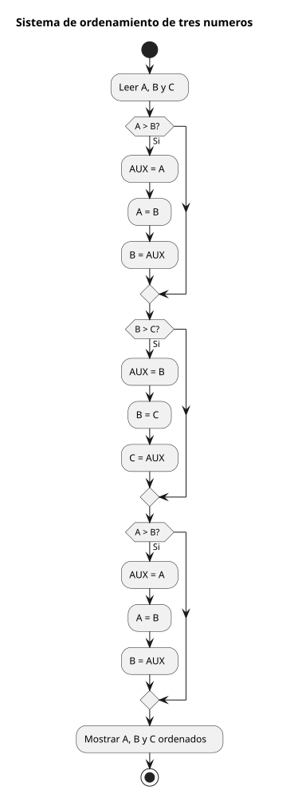

# Semana 1 · Ordenar tres números

Se implementó un algoritmo en PSeInt que ordena tres números enteros de menor a mayor usando **únicamente comparaciones e intercambios**: no usa listas, ciclos anidados ni funciones de ordenamiento de biblioteca.

## Archivos

- [`OrdenarTresNumeros.psc`](./OrdenarTresNumeros.psc) — algoritmo en sintaxis PSeInt, listo para abrir y ejecutar en PSeInt.
- [`OrdenarTresNumeros.svg`](./OrdenarTresNumeros.svg) — diagrama de actividad exportado desde PSeInt.

## Cómo funciona

El programa pide tres números por teclado y aplica tres comparaciones consecutivas, intercambiando los valores cuando corresponde:

1. Si `A > B`, se intercambian.
2. Si `B > C`, se intercambian.
3. Si `A > B`, se intercambian.

La tercera comparación es necesaria porque el segundo intercambio puede dejar a `A` y `B` desordenados de nuevo. Al terminar, los tres valores quedan en orden ascendente.

Como solo usa comparaciones y swaps, funciona igual con números repetidos y con valores negativos.

## Código

```pseint
Algoritmo OrdenarTresNumeros

    Definir A, B, C, AUX Como Entero

    Escribir "Ingrese el primer numero:"
    Leer A

    Escribir "Ingrese el segundo numero:"
    Leer B

    Escribir "Ingrese el tercer numero:"
    Leer C

    Si A > B Entonces
        AUX <- A
        A <- B
        B <- AUX
    FinSi

    Si B > C Entonces
        AUX <- B
        B <- C
        C <- AUX
    FinSi

    Si A > B Entonces
        AUX <- A
        A <- B
        B <- AUX
    FinSi

    Escribir "Numeros ordenados de menor a mayor:"
    Escribir A
    Escribir B
    Escribir C

FinAlgoritmo
```

## Ejemplo de ejecución

```
Ingrese el primer numero: 7
Ingrese el segundo numero: 2
Ingrese el tercer numero: 5
Numeros ordenados de menor a mayor:
2
5
7
```

## Diagrama de actividad


